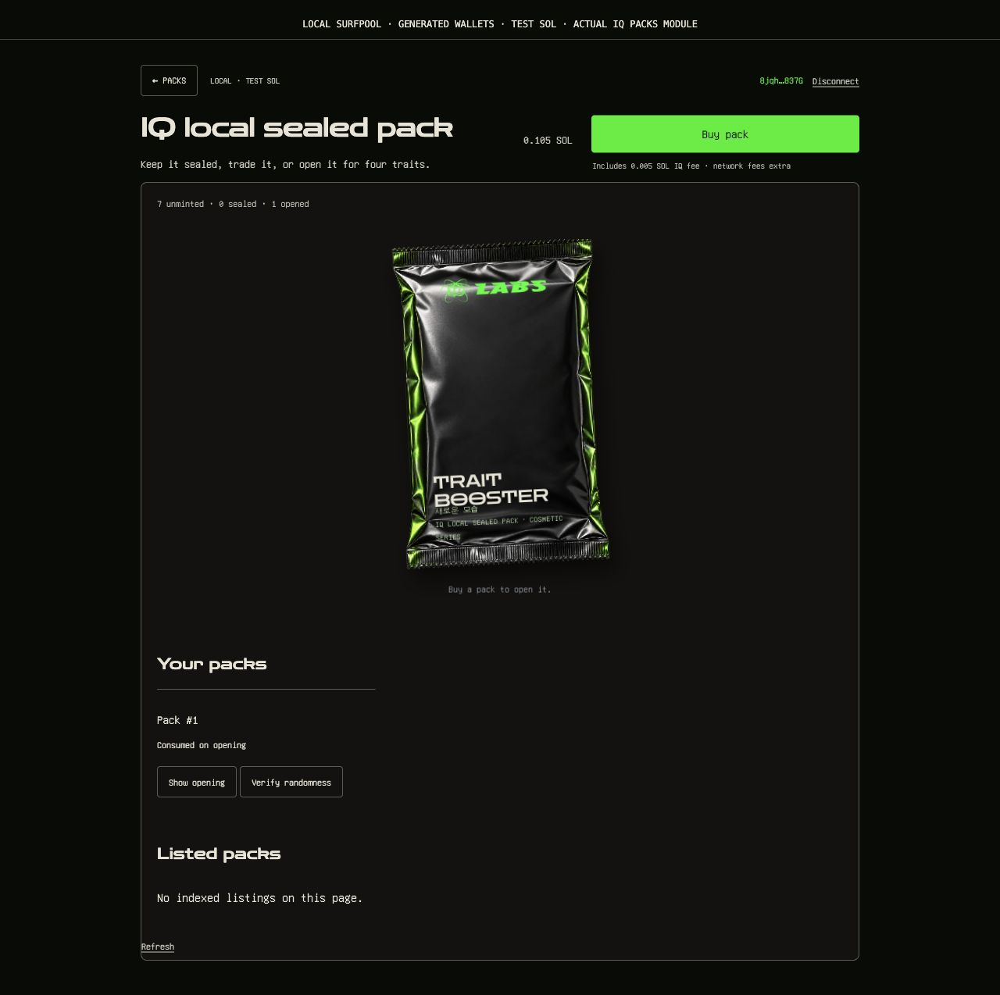
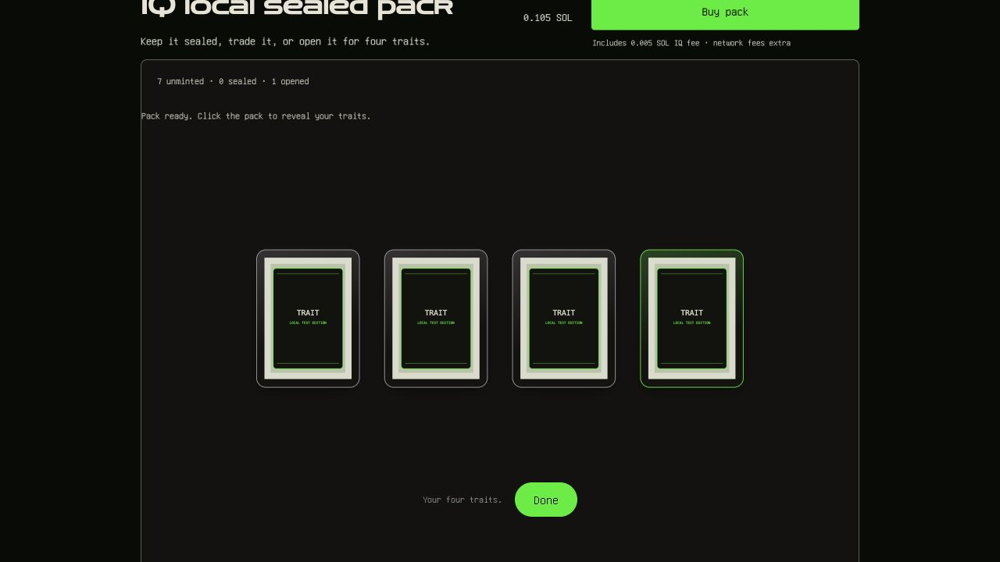
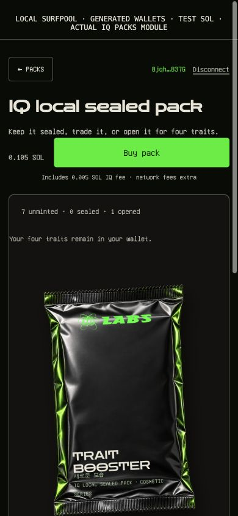

# Sealed packs: local review evidence

Captured from the actual optional IQ packs module on Surfpool, using disposable generated wallets and test SOL. These synthetic trait images are QA fixtures, not final collection media. No private Nubbies source art, layers or personal keys are included.

The paired client repeated buy/list/cancel/relist/resale/open/index/delivery. The refreshed frontend passes 57 pack checks plus 137 NFT/site regressions; the companion passes 73 client and 47 backend checks. The mainnet launch changes are retained and pack deployments remain explicitly opt-in.

These receipts do not prove public oracle/provider or external-marketplace ingestion acceptance. Production deployment, capital/escrow policy and permanent media still require review.

[Opening video](sealed-opening.mp4)
