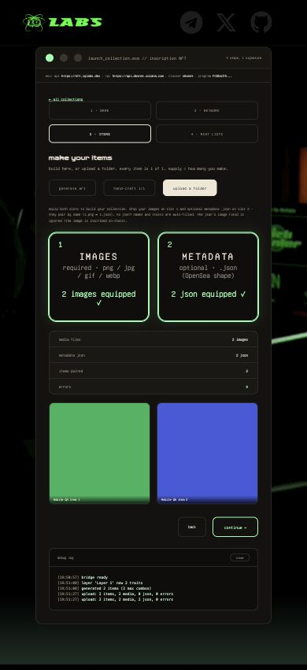
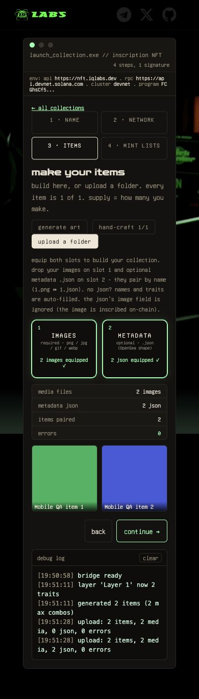

# NFT creator mobile evidence

Base: `9928df19599551b13b5caa73580a5ec01e522042` (`master`). Captured 2026-10-26 in Chrome at 390px. Before is untouched master; after adds the mobile fixes. Both use the same collection details and disposable 32px PNG/JSON files.

Preserves the newer studio: separate IMAGES/METADATA slots, preview placeholder, Make Items → Continue, Regenerate, and deploy-stage/success-lock logic. Browser-tested name/network navigation, two-item generation/regeneration, separate image/JSON pairing and final review. Mobile inputs are 16px; generator fits at 320/390/600px. Desktop keeps the original two-column preview. No wallet signing, remote image upload or chain write; physical devices and post-deployment UI not exercised.

The focused NFT tests pass 20/20; the full suite passes 127/127, no skips (Node 24.18.0). Run `npm ci --ignore-scripts && npm test` in tests/. This checkout used the already-installed matching jquery/jsdom through NODE_PATH. The network-import fixture loads the real nft_net.js; feed checks follow the current 100-row requests and 300-row display bound. Test changes do not modify production behavior. Full output: [tests.txt](tests.txt).

| Screen | Before | After |
| --- | --- | --- |
| Collection details |  |  |
| Generator |  |  |
| Separate upload slots |  |  |
