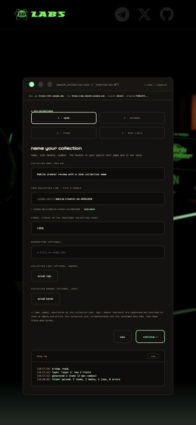
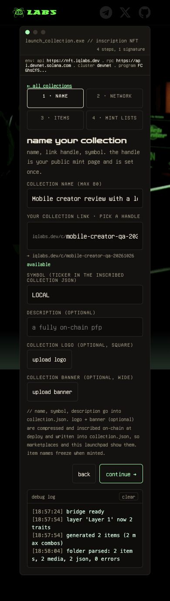
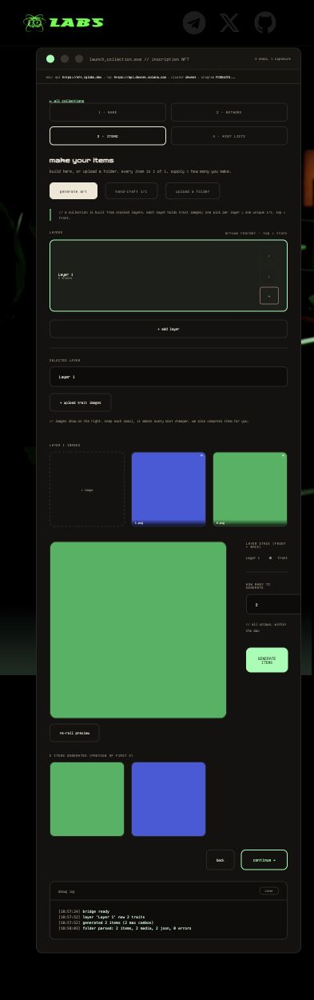
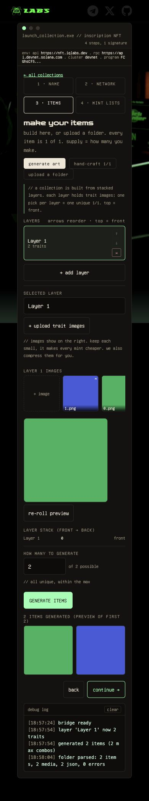

# NFT creator mobile evidence

Original: `def237cd213bdd77cb433b6889206edee6cc1402` (`feat/inscription-nft`). Captured 2026-10-26 in Chrome with a 390px viewport. Before/after use the same collection details and disposable 32px PNG fixtures. Full-page screenshots retain the existing fixed site header.

Checked 320/390/600px: name/network navigation, two-item art generation, hand-crafted image editing, two PNG/JSON pairs and final price/deposit/royalty/assignment summary. No document horizontal overflow in the tested candidate states; the trait gallery scrolls within its own container. Native trait-prompt entry and physical-device/wallet-signing acceptance are not claimed. No remote upload, deployment or chain write was performed.

The source change is mobile CSS only, plus template/script cache versions. Desktop rules, transaction behavior and fees are unchanged.

| Screen | Before | After |
| --- | --- | --- |
| Collection details |  |  |
| Generator |  |  |
