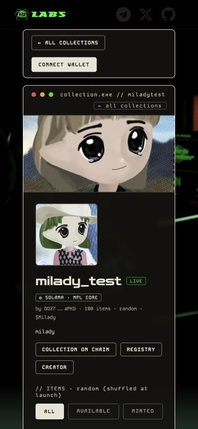
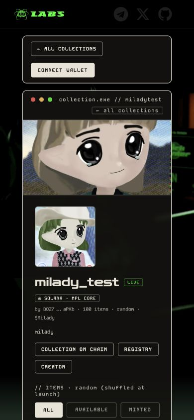
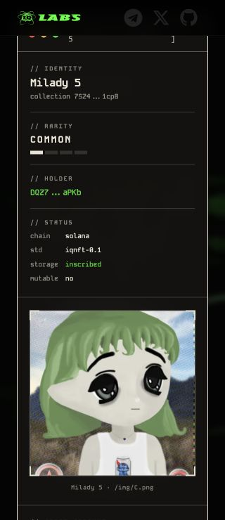
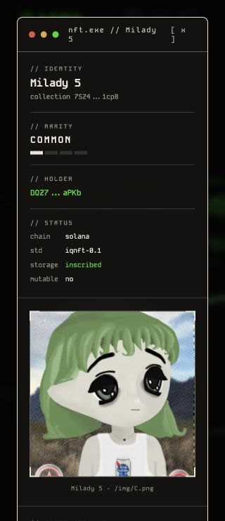

# NFT header clearance

Chrome viewport checks, 2026-10-26; base 26962b290959b369cca7278dae8214c820074ad3. Page comparison 390px; viewer comparison 320px. Same existing devnet NFT on both sides.

The fixed site header used z100 while the NFT viewer used35, hiding its title/close control. Viewer101 and metadata102 restore the overlay order. The page also independently sized its top padding; NFT screens now reserve the shared header-height value. Header dimensions are unchanged; the clearance rule applies only while main_section contains nftl or nfts.

Collection clearance measured 14px at 320/390/600/1280; document width equals viewport. Actual viewer close preserves clearance; list 14px and creator 16px. The close control receives pointer input, metadata opens above the viewer, and metadata dismissal leaves the viewer open. Desktop close control also checked at 1280px. No wallet signing, uploads or chain writes; physical devices not tested.

| | Before | After |
| --- | --- | --- |
| Collection page |  |  |
| NFT viewer |  |  |
