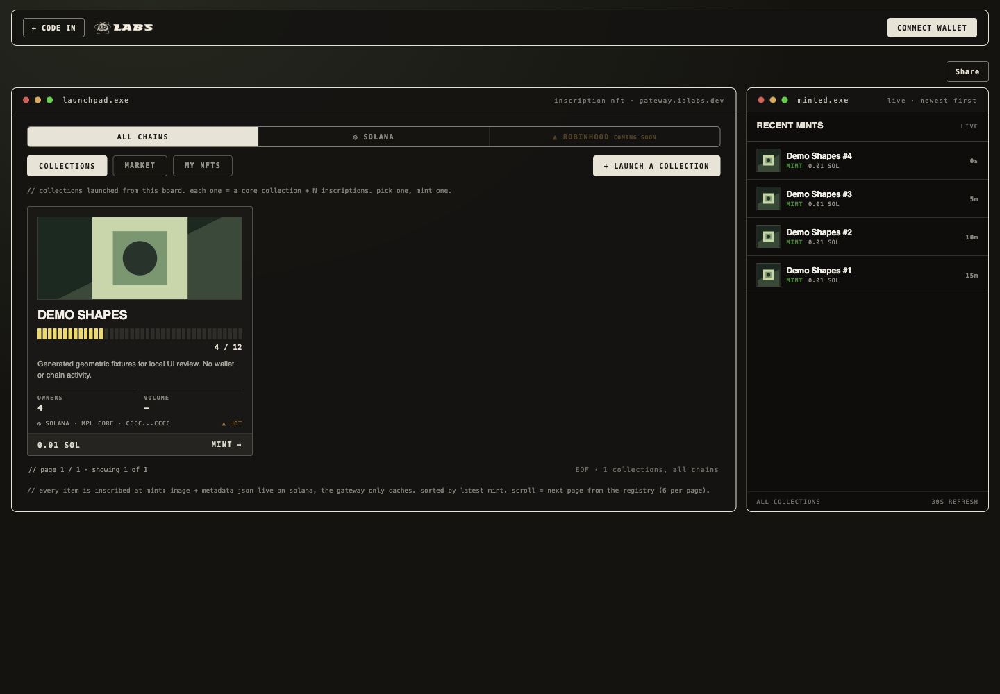
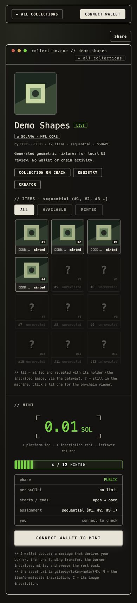
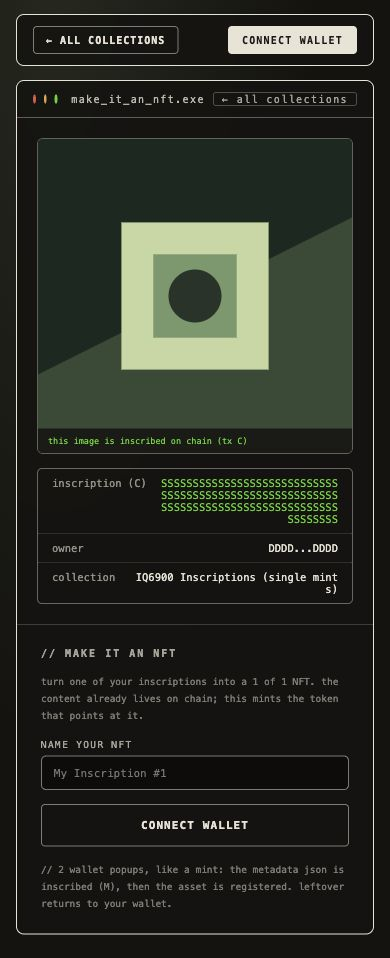

# NFT wording and share-control review

Captured from the actual edited NFT HTML/controller with read-only generated geometric fixtures. This is source UI evidence, not a mainnet mint or marketplace acceptance. The official IQ logo is byte-exact from the existing frontend asset. No wallet, native Share or clipboard action was sent during capture.

The capability fixture enables Share; old/unreachable backend fixtures hide it. Desktop 1440x1000 and mobile 390x844 were reviewed. The control uses a wrap-safe row outside the existing nav; NFT viewer sharing uses the existing action grid.

Functional DOM tests separately cover actual deep links, owner guards, native/canceled sharing, clipboard/manual-copy fallback and viewer actions.
